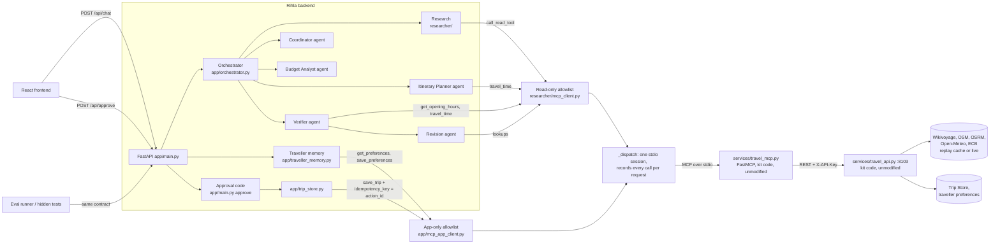

# Rihla: MCP implementation

How Rihla reaches the client's system through the Model Context Protocol, which code may call which tool, and the
evidence that it works. Paths are relative to `kit/`. Verified on 2026-10-30.

## 1. What the bootcamp requires

| Source | Requirement |
|---|---|
| `Final-Mini-Project/README.md:83` (Definition of Done #2: "a system missing any of them cannot pass") | "The client's system is reached **through its MCP server** (it shows in `tool_calls`), **and** at least one real external API" |
| `Final-Mini-Project/README.md:43` | The kit gives "the client's system of record … **plus its MCP server**"; the team builds "the **MCP client side** and every tool decision" |
| `Final-Mini-Project/README.md:98-104`, `common/CONTRACT.md:72-85` | "The LLM proposes. Your code commits." `/api/approve` (your code, not the LLM) "calls the write tool **over MCP** with exactly that payload and Idempotency-Key = action_id"; the write tool is not in the LLM's tool list; an unknown or already used `action_id` gets a clear reply and writes nothing again |
| `common/CONTRACT.md:28-49` | ChatResponse: `reply` always; `pending_action` only when waiting for approval; `result` only after the system confirmed the write; `citations`; `tool_calls` ("every tool your agent called in this turn: name, success, milliseconds"); `usage` optional |
| `Final-Mini-Project/README.md:84`, `scenario-3-trip-planner/README.md:124`, kit `README.md:147-148` | Persistent memory: a returning traveller's preferences are read (`get_preferences` when a session starts) and updated (`save_preferences` when the traveller states a lasting preference) |
| `common/RUBRIC.md:44` | "MCP used for the client's system" |
| `Final-Mini-Project/README.md` ("Don't change the simulated systems") | The kit's travel API and MCP server stay unmodified |

## 2. Architecture

The **only** route from Rihla's code to the travel API is the MCP server. `app/trip_store.py` no longer imports
`httpx`; the approved save is the MCP `save_trip` tool.

## 3. Server, client and tools

| Part | Where | Notes |
|---|---|---|
| MCP server | `services/travel_mcp.py` | Kit code, unchanged (its only commit is the trainer's). FastMCP, stdio, 11 tools, each forwarding to the REST API with `X-API-Key`. |
| MCP client | `researcher/mcp_client.py` | `stdio_client` + `ClientSession`; one shared server process for all calls (`_SharedSession`), restarted once if the pipe breaks. Dependency `mcp==1.28.1`. |
| Agents' read path | `call_read_tool` in `researcher/mcp_client.py` | Allowlist `READ_ONLY_TOOLS`: geocode, find_attractions, find_restaurants, get_opening_hours, get_weather, convert_currency, travel_time |
| Application path | `call_app_tool` in `app/mcp_app_client.py` | Allowlist `APP_TOOLS`: save_trip, get_preferences, save_preferences. Never given to an agent. |
| Recorder | `_dispatch`, `recording()`, `stage()` in `researcher/mcp_client.py` | Every MCP call, read or write, passes here and is recorded for the current request |

| Tool | Who calls it | Permission |
|---|---|---|
| find_attractions, find_restaurants, convert_currency | Research step (`researcher/researcher.py`) | read |
| get_opening_hours | Research (required places), Verifier, Revision | read |
| travel_time | Itinerary Planner (inside its `check_day` tool), Verifier, Revision | read |
| geocode, get_weather | Allowed to the Researcher agent's tools; not called by the current pipeline | read |
| get_preferences | Chat endpoint, first message of a session with an identified traveller | app read |
| save_preferences | Chat endpoint, only when the traveller asks to remember something | **app write** |
| save_trip | `/api/approve`, after every approval check | **app write** |
| list_trips | Not used | — |

**Read-only boundary, enforced in code:**
- An agent tool can only call `call_read_tool`, which raises `ToolNotAllowed` for any other name before anything is sent (`researcher/mcp_client.py`).
- The Researcher's CrewAI tools are read tools only (`researcher/tools.py`).
- `call_app_tool` refuses any tool outside its three.

## 4. Approval flow (writes through MCP)

1. `/api/chat` offers a `pending_action` only when the existing gate passes (`app/main.py`): verifier PASS, `verified`, live (`fresh`) evidence, sufficient coverage. **This gate is unchanged.**
2. The `pending_action` holds `action_id`, `type: save_trip`, a `summary` the human approves, and `payload: {traveller_id, title, itinerary}`, which is exactly what will be sent. It also keeps an `itinerary_hash`.
3. `/api/approve` (`app/main.py`), under a lock, handles the outcomes:
   - **Unknown `action_id`:** clear reply, nothing written.
   - **The same decision again** (double click): the earlier `trip_id` is returned and nothing is written again.
   - **Reject:** clear reply, nothing written.
   - **Not verified, or the hash no longer matches:** 403, nothing written.
   - **Otherwise:** `save_trip_to_store` calls the MCP `save_trip(traveller_id, title, itinerary, idempotency_key=action_id)`.
4. Success is reported only when MCP returns `ok: true` with a `trip_id` like `TRIP-3001`. The reply carries the ID and `result: {"trip_id": ...}`.
5. A failed, refused, malformed or unreachable save gives `status: save_failed`, `result: null` and an honest reply. The pending action is kept, so the traveller can retry. A retry is safe: the same `action_id` is the same idempotency key, so the Trip Store returns the same trip. This also covers the shared session re-sending a call after a broken pipe. There is no REST fallback.

## 5. Memory flow (through MCP)

- **Identity:** the request's `user.traveller_id` (CONTRACT §1 and §5). It must be 2–40 characters from `A-Za-z0-9_.-`, as the Trip Store requires. A session belongs to one traveller; a second one in the same session is refused (`traveller_mismatch`) and sees nothing.
- **Load:** `get_preferences` once per session, on the first message (`app/traveller_memory.py:session_preferences`).
  - Loaded: the reply says so ("Your saved preferences: diet: vegetarian; …").
  - `traveller_not_found`: nothing is said or invented.
  - Unavailable: the reply says so and planning continues without them.
- **Use:** `apply_preferences` fills only what this request did not say: interests (mapped to Travel API tags), budget style, maximum walk, currency, party size. What was used is listed in the reply ("Used for this plan: …").
  - Dietary needs are stated with the kit's caveat (listings do not certify diets). The planning code does not filter restaurants by diet (see §8).
- **Save:** only when the message asks for it ("remember…", "from now on…", "always…", "update my preferences"), and only for fields the Trip Store knows (diet, walking limit, budget style, home currency, interests).
  - Lists are merged with the stored ones, because the store replaces a list it is sent. Empty values are never sent.
  - A message without such a request saves nothing.
- **Logs:** traveller data is never logged. Tool-call records hold tool names, outcomes and times only.
- **The React page** sends no `user` yet, so its trips use `TRAVEL_TRAVELLER_ID` as before (a fallback for saving only; memory is not loaded for it).

## 6. Tool-call reporting

- `/api/chat` and `/api/approve` open a `recording()` per request. A `ContextVar` keeps concurrent requests apart.
- Each MCP call is recorded where it is made (`_dispatch`) as `{"tool", "ok", "ms", "agent", "via": "mcp"}`, plus `"error"` (the tool's error code, or `mcp_unavailable (…)` when the server could not be reached). Arguments and results are not recorded.
- `agent` is the stage that made the call: `researcher`, `itinerary_planner`, `verifier` or `revision`, set by `stage()` in `app/orchestrator.py`, `app/planning_adapter.py` and `app/verification_adapter.py`.
- Each agent's own Python tool calls (`check_selection`, `check_day`, `inspect_verification`, `inspect_revision_options`, logged by the tools themselves) are added after that agent's stage with `"via": "python"`. So "who did what" is visible. Within one stage the MCP calls come first, then the agent's own calls.
- **`usage`:** the token counts CrewAI reported in this request (the Coordinator's run plus the planning agents' shared counter). `cost_usd` is an estimate from the model's list price, `null` for an unknown model, and `0` when no LLM was called.
- **`citations`:** one `{id, title, url}` per distinct activity `source_url`, in plan order.
- **`reply`:** written by Python: a day-by-day plan with times, estimated costs, unknown prices, walking or driving minutes, price conflicts and verification findings; otherwise the backend's message.

## 7. Error handling

| Situation | Behaviour |
|---|---|
| A tool answers `ok: false` (e.g. 503 from the API) | Returned to the caller as before; recorded with `ok: false` and its code |
| The MCP server cannot start or the pipe breaks | One automatic restart; then the exception propagates; recorded as `mcp_unavailable` |
| An agent asks for a write tool | `ToolNotAllowed` before anything is sent; not recorded (nothing was invoked) |
| `save_trip` fails, conflicts (409), returns no or a non-`TRIP-` id | `save_failed`, `result: null`, pending action kept |
| `get_preferences` unavailable | Planning continues; the reply says preferences could not be loaded |
| `save_preferences` refused or unavailable | The reply says it was not remembered |

## 8. Evidence

All runs were offline: no OpenRouter call (`OPENROUTER_API_KEY` blank, base URL set to a dead local port).

| Suite | What it proves | Result |
|---|---|---|
| `tests/test_mcp_integration.py` (12) | **Real stdio.** It starts the kit's travel API (replay, own port and key) in a subprocess; our client spawns the kit's `services.travel_mcp`. It checks: tool discovery (all 11); a read (Topkapı closed on Tuesdays) that reaches the API log; an API 503 that comes back as a failed call; a server that cannot start, which raises and is recorded; the Researcher refused `save_trip` / `save_preferences`; approval saves once through MCP with the store's `TRIP-` id (the API log shows `POST /api/trips`); the double click writes nothing; the idempotency key protects a repeated save; rejection saves nothing; a store 503 is reported and the retry saves; preferences are read, merged on save, scoped to their traveller, and created only on request | 12 passed |
| `tests/test_mcp_contract.py` (45) | Recorder outcome, timing, no arguments, nothing outside a request, no leaks, 3 concurrent threads; allowlists; research calls; the **genuine CrewAI Itinerary Planner loop** (scripted LLM) whose `check_day` lookups over MCP are recorded once each as `itinerary_planner`; planning- and verification-adapter ordering; `/api/chat` contract fields; usage arithmetic; concurrent chat requests; approval payload equals the MCP `save_trip` arguments; failure, malformed and unreachable saves; no REST fallback (httpx blocked); memory load, use, merge, consent, isolation and unavailability | 45 passed |
| `tests/test_api.py` | Existing approval tests, three updated to the contract (see §9) | 10 passed |
| Official eval runner (`evals/run_evals.py`) against our app over HTTP, with the real MCP server and travel API (replay); **only the LLM pipeline replaced by a deterministic stub** that makes one real MCP call | S3-02 approve (`TRIP-` id, one trip for TRV-200 with the right dates), S3-03 reject, S3-08 memory (`get_preferences` in `tool_calls`, "vegetarian" in the reply, `pending_action` save_trip), S3-10 clarification, plus a double-approval case (one trip, same id) | 5/5 passed |
| Whole backend suite | No regressions | 900 passed, 10 skipped (the paid live tests), 0 failed |
| Frontend | Unchanged; its approval client already accepts the contract shape | 91 passed, lint clean, build OK |

## 9. Changes to existing behaviour

- `/api/approve` now returns a ChatResponse with HTTP 200 for:
  - an unknown or mismatched `action_id` (`no_pending_action`; was 404 or 400);
  - a failed save (`save_failed`; was 503);
  - a repeated approval (`approved`, same `trip_id`; was 404).

  Three assertions in `tests/test_api.py` were updated to this contract behaviour. Their safety checks (no save, exactly one save, pending kept) are unchanged. The unverified and tampered cases still answer 403.
- The approved save sends a `title` ("Istanbul, 2 days") and the `traveller_id` stored in the pending action.
- `scripts/try_revision.py`: `only_hosts()` restored `socket.create_connection` to the *test's stand-in* instead of the original, leaking a fake socket factory into every later test. It is now fixed to restore the original (a test helper; behaviour inside the guard unchanged).

## 10. Remaining limitations

1. **Replay mode still offers no approval** (team decision, not changed here). A `pending_action` needs live (`fresh`) evidence, so with the kit's default replay data the real pipeline never offers `save_trip`. The approval path above is proven with a verified result supplied by the test. The policy proposal is in `RIHLA_TEAM_HANDOFF.md` §3 (P1).
2. **No real end-to-end planning run** was made here (it needs paid LLM calls). Reporting from the live agents is covered by unit and scripted-LLM tests, not a live run.
3. Dietary preferences are reported and used in the reply but not used to filter restaurants (`planning/` has no diet input).
4. `ui/app_ui.py` (the kit's Gradio starter) can now read `reply`; it was not exercised.
5. `/api/chat` still clears a pending approval on every message, including a memory-only message (`RIHLA_TEAM_HANDOFF.md` B3).
6. User-requested revision is still not connected (`RIHLA_TEAM_HANDOFF.md` B4/P2).

## 11. Compliance

| Requirement | Status | Evidence | Tests |
|---|---|---|---|
| MCP server (kit's, unmodified) | VERIFIED | `services/travel_mcp.py`; git history shows only the trainer's commit | integration: tool discovery |
| MCP client (ours) | VERIFIED | `researcher/mcp_client.py` stdio `ClientSession` | integration: read, failure, server-cannot-start |
| Real MCP tool calls in the pipeline | VERIFIED (offline) | research, planner `check_day`, verifier and revision lookups all go through `_dispatch` | contract: research, real CrewAI planner loop, adapters |
| Tool calls in `tool_calls` | VERIFIED | `app/main.py` + recorder | contract: chat fields, isolation; runner: `tools_used_include` |
| One real external API | IMPLEMENTED BUT NOT VERIFIED here | live travel data (Wikivoyage, OSM, OSRM, Open-Meteo, ECB) in `live` mode; OpenRouter LLM | not run (no paid or live calls) |
| Approval write through MCP | VERIFIED | `app/trip_store.py` → MCP `save_trip`; no `httpx` | integration: saves once, API log; contract: exact payload |
| Idempotency (`action_id`) | VERIFIED | `idempotency_key = action_id`; repeated approvals answered without a write | integration: double click, repeated save; runner: double-approval case |
| Memory through MCP | VERIFIED | `app/traveller_memory.py` → `get_preferences` / `save_preferences` | integration: read, merge, scope, create; runner: S3-08 |
| Security boundaries (read-only agents, app-only writes, no LLM write) | VERIFIED | two allowlists, checked before sending | contract + integration |
| API contract (`reply`, `pending_action.summary/payload`, `result`, `citations`, `tool_calls`, `usage`) | VERIFIED for the fields; PARTIAL for the outcomes | `app/schemas.py`, `app/contract.py` | runner: S3-02/03/08/10 pass with the stubbed pipeline. Sample cases needing a real plan (S3-01, 04–07, 09) also depend on limitations 1, 2 and 6 |
| Integration tests of the real MCP connection | VERIFIED | `tests/test_mcp_integration.py` | 12 passed |

**The MCP requirements of Definition of Done #2 and the approval rules of the contract are met and tested.**
The project as a whole is not yet fully compliant: replay-mode approvability, user revision and a live run remain.
