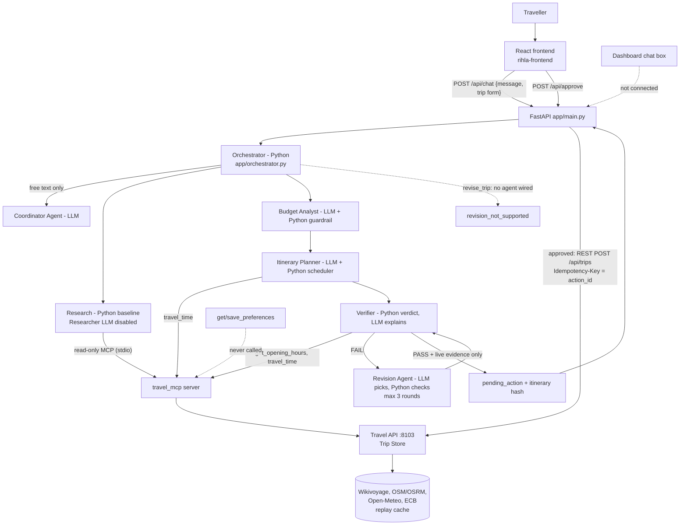

# Rihla AI Trip Planner: project audit and readiness assessment

**Audit date:** 2026-10-30 · **Branch audited:** `feature/global-data-frontend` @ `c763202` · **Scope:** `Final-Mini-Project/scenario-3-trip-planner/`
**Method:** git inspection, source reading, offline test runs, read-only probes of the services already running. No code was changed, nothing was merged or committed, and no paid LLM calls were made.

Every finding below is tagged:

- **[VERIFIED]**: I observed it directly (code read, test run, HTTP response).
- **[INFERRED]**: follows from verified facts, but I did not run it end to end.
- **[NOT VERIFIED]**: needs a paid/live run or a person to check.

---

## A. Executive summary

The engineering inside the pipeline is strong. Five CrewAI agents with Python guardrails, a strict approval gate, sourced prices, opening-hours checks and measured walking times are all implemented. **820 backend tests and 68 frontend tests pass**, lint is clean and the production build works.

The project is **not yet passing-grade against the brief**. The problem is not missing intelligence. It is mostly the **outer layer the graders and hidden tests touch**:

1. **The API does not speak the bootcamp contract** [VERIFIED]. `/api/chat` returns `status/itinerary/message`. It never returns `reply`, `citations`, `tool_calls` or `usage`. `/api/approve` returns `{status, message, trip}`, not a ChatResponse with `result.trip_id`. The eval runner and the ~15 hidden tests read exactly these fields, so **close to all sample cases fail today regardless of plan quality** [INFERRED from `evals/run_evals.py` lines 192–260].
2. **No plan can be approved in replay mode** [VERIFIED in code]. `verified=True` requires every hours and route fact to come from a *live* lookup (`planning/verification.py:16-18, 301`), and `/api/chat` only issues a `pending_action` when `verified` is true (`app/main.py:97-106`). Replay is the kit default and probably what the hidden tests use. In live mode, the only recorded real run (`rihla-frontend/src/data/recordedAmmanResult.js`) also ended `verification_required`. **No artifact in the repo shows a real run reaching `pending_approval`.**
3. **"Revise without restarting" is not connected** [VERIFIED]. The orchestrator calls `revise_itinerary()` with no agent (`app/orchestrator.py:265`), which always raises `RevisionNotAvailableError`. The dashboard chat says "Changes from this chat aren't connected yet" (`TripDashboard.jsx:231`). The revision agent that exists only repairs verifier failures; it cannot "make day 2 cheaper" or "cut the budget by 20%".
4. **Persistent memory is missing** [VERIFIED]. `get_preferences` / `save_preferences` are never called. The traveller ID comes from an env var, not the request's `user`.
5. **Definition-of-Done deliverables are missing** [VERIFIED]: no `DESIGN.md`, no portfolio README (the frontend README is the Vite template), no app Dockerfile (the `app:` block in `docker-compose.yml` is commented out), no own eval cases, no scorecard, no "failure fixed" write-up.

Git integration is in good shape: **every teammate branch is fully contained in the current branch**. The only gap is that `origin/main` lacks the last three commits (PDF export, real approval flow, 5-minute timeout).

---

## B. Git integration status

`git status` [VERIFIED]: clean working tree. `feature/global-data-frontend` equals `origin/feature/global-data-frontend` (`c763202`). Untracked: `rihla-frontend/src/pages/TripDashboard.jsx.bak` + 22 geocode/route cache JSONs (left untouched).

`git fetch origin --prune` showed that **`origin/main` moved during the day**: PR #12 (`planning-budget-reliability`) and PR #11 (this branch, at an earlier commit) were merged.

| Remote branch | Last commit | Author | Commits not in our HEAD | Status |
|---|---|---|:--:|---|
| `origin/main` | `5606aeb` 2026-10-30 Merge PR #11 | SHAHDmu8 | 2 (merge commits only, no content) | **Behind us by 3 content commits** |
| `origin/feature/planning-budget-reliability` | `87f0c30` 2026-10-30 | demadabbagh | 0 | Integrated |
| `origin/fix/interest-normalization` | `aec0cb3` 2026-10-30 (WIP checkpoint) | demadabbagh | 0 | Integrated |
| `origin/feature/coordinator-orchestration` | `d06adfe` 2026-10-29 | SHAHDmu8 | 0 | Integrated |
| `origin/feature/targeted-revision` | `ec8f3cd` 2026-10-28 | demadabbagh | 0 | Integrated |
| `origin/feature/verifier-agent` | `af8a286` 2026-10-28 | demadabbagh | 0 | Integrated |
| `origin/feature/research` | `32cdd06` 2026-10-28 | doaa-ab | 0 | Integrated |
| `origin/feature/itinerary-planner` | `2c43e24` 2026-10-27 | demadabbagh | 0 | Integrated |
| `origin/feature/budget-analyst` | `cb7b353` 2026-10-27 | demadabbagh | 0 | Integrated |
| `origin/feature/planning-intelligence` | `efd7a4a` 2026-10-27 | demadabbagh | 0 | Integrated |

**`git diff origin/main HEAD`** [VERIFIED]: HEAD only *adds* to main: 13 files, +1476/−54 (PDF export, `approval.js`, sample trips, My Trips upgrades, timeout). Since the merge base, main has no content that HEAD lacks.

**Team contributions (2026-10-20 onward, scenario folder)** [VERIFIED]:

| Member (git handle) | Area actually touched |
|---|---|
| SHAHDmu8 | `rihla-frontend/` (34 file-changes), `app/main.py`, `app/orchestrator.py`, `services/travel_data.py`, API tests |
| demadabbagh (also commits as "דימה דבאג") | all of `planning/` (budget, planner, verifier, revision), `tests/planning/`, fixtures, some frontend |
| doaa-ab | `researcher/` (MCP client, tools, validate), `tests/research/`, `scripts/try_*`; last commit 2026-10-28 |

`Mohammad Abu Alhalawe` commits are course material (trainer), not team work. `abuzaid268` made the repo's initial commit only.

**Open PRs:** I could not check them because the `gh` CLI is not installed. Check on GitHub whether a PR for the 3 new commits exists.

**Conclusion:** all three members' code is integrated in this branch [VERIFIED]. To get it onto `main`: open a PR `feature/global-data-frontend → main`.

**Repository concern** [VERIFIED]: the project lives inside the course repo `demadabbagh/Agentic-AI-Bootcamp-Students` (310 project files beside ~400 course files). The brief asks for "a public repo, product name". Confirm with the trainer whether this layout is accepted.

---

## C. Feature-by-feature status

| Component | Purpose | Implemented | Connected | Tested (offline) | Real data | Key limitations / bugs | Evidence |
|---|---|---|---|---|---|---|---|
| **Frontend** (React/Vite) | Trip form, dashboard, My Trips, PDF | Yes | Yes, via Vite proxy → `:8000` | 68 unit tests (services only, no component/E2E tests) | Yes when the backend runs | Login is a fake "coming soon" alert; chat box not connected; My Trips is browser-local only; README is the Vite template | `src/pages/*.jsx`, `src/services/*.js`, `Login.jsx:26-32`, `TripDashboard.jsx:219-234` |
| **Backend API** (FastAPI) | `/health`, `/api/chat`, `/api/approve` | Yes | Yes | `test_api.py`, `test_chat_response.py`, `test_api_contract.py` | — | **Not the bootcamp contract** (no `reply/citations/tool_calls/usage/result`); approve errors are HTTP 4xx, not ChatResponse; sessions are in-memory and lost on restart; `user` field ignored | `app/main.py`, `app/schemas.py:37-52` |
| **Coordinator** | Intent + field extraction from free text | Yes (CrewAI, 1 agent) | Yes | Mocked in tests | LLM | **Skipped entirely** for the form path without preferences (`orchestrator.py:238-240`); `max_iter=3`, no `max_rpm`; its tokens are not counted in cost | `app/coordinator.py` |
| **Orchestrator** | Python sequencing of all stages | Yes | Yes | `test_orchestrator.py` (6) | — | Plain Python pipeline, not a CrewAI manager; revision branch is dead code; `mock_agents.py` still imported (used only by unused `_verify_itinerary`) | `app/orchestrator.py`, `app/mock_agents.py` |
| **Research Agent** | MCP lookups → `ResearchBundle` | Yes | Yes | `tests/research/`, adapter tests | Yes (MCP → Travel API) | **Runs with `use_llm=False` in production**: research is deterministic code; the CrewAI researcher agent is never invoked by the API | `app/research_adapter.py:177`, `researcher/researcher.py:105-112` |
| **Budget Analyst** | Select/rank places, price them, totals | Yes (CrewAI + Python) | Yes | Extensive (`test_budget*.py`) | LLM + listing prices + ECB FX | Python fills and overrides bad picks; conflicting prices become ranges | `planning/budget_analyst.py`, `planning/budget.py` |
| **Itinerary Planner** | Day assignment + timed schedule | Yes (CrewAI + Python scheduler) | Yes | Extensive | LLM + MCP `travel_time` | Falls back to a Python plan (labelled `python_fallback`); walking is the only mode, except a driving lookup for long walks | `planning/itinerary_planner.py`, `planning/schedule.py` |
| **Verifier** | Hours, overlaps, walks, budget, sources | Yes: Python verdict + LLM ranking/explanation | Yes | Extensive | MCP `get_opening_hours`, `travel_time` | **`verified` requires live ("fresh") evidence**, so replay can never pass | `planning/verification.py:16-18,301`, `planning/verifier_agent.py` |
| **Targeted revision (repair)** | Fix verifier failures, ≤3 rounds | Yes | Yes (inside verification) | Extensive | Same lookups | Only verifier-driven; untouched days copied verbatim | `planning/revision.py`, `planning/revision_agent.py`, `app/verification_adapter.py:67-96` |
| **User revision** ("make day 2 cheaper") | Change the current plan on request | **No** | **No** | `app/revision.py` unit-tested only with a fake agent | — | Always returns `revision_not_supported` | `app/orchestrator.py:257-277`, `app/revision.py` |
| **Travel API / MCP server** | Kit's gateway + 11 MCP tools | Yes (kit, plus team changes) | Yes | `test_destination_resolution.py`, `test_wikivoyage_districts.py`, `test_google_places.py` | Yes | Team modified `services/travel_data.py` (worldwide geocoding, User-Agent) and added `google_places.py`. **The brief says "Don't change the simulated systems"**; hidden tests run against the original | `services/*.py`, `git log -- services/` |
| **Trip persistence** | `save_trip` after approval | Yes | Yes | `test_api.py` (mocked store) | Travel API `POST /api/trips` | Traveller ID from `TRAVEL_TRAVELLER_ID` env, not the user (missing from `.env.example`); `trip_store.py` default URL `:8001` is wrong (kit uses `:8103`) | `app/trip_store.py:52-55`, `app/main.py:239` |
| **Persistent memory** | Traveller preferences | **No** | — | — | — | `get_preferences`/`save_preferences`/`list_trips` never called | grep over `app/ planning/ researcher/` |
| **PDF export** | Download plan | Yes (jsPDF, client-side) | Yes | 4 tests | Uses real result | Exports any trip, not only approved ones (stretch goal says "after approval") | `src/services/tripPdf.js`, `demoFeatures.test.js:150-195` |
| **Approval gate** | No write without approval | Yes, strong: hash-pinned payload, lock, idempotency key, 403 on unverified | Yes | `test_api.py`, `approval.js` tests | — | Unreachable in practice, because nothing is ever `verified` (see A.2) | `app/main.py:97-135,171-269` |
| **Error handling** | Classified errors, no secrets | Yes | Yes | `test_diagnostics.py`, `test_chat_response.py` | — | Good: error IDs, redacted tracebacks, 5-min client timeout | `app/diagnostics.py`, `tripApi.js:50-104` |
| **Gradio UI starter** | Kit's UI | Present (kit) | **No**: reads `reply`, which our API never sends | — | — | Will show nothing useful with our API | `ui/app_ui.py:62-66,212` |

---

## D. Bootcamp requirements compliance matrix

Sources: `Final-Mini-Project/README.md` (Definition of Done, rubric summary), `scenario-3-trip-planner/README.md` (must-haves, demo scenarios, hidden tests), `common/CONTRACT.md`.

### D.1 Definition of Done: mandatory ("A system missing any of them cannot pass")

| # | Requirement | Implemented? | Tested? | Evidence | Missing work |
|---|---|---|---|---|---|
| 1 | Real agentic workflow, ≥2 specialised roles, explicit state | **Yes** (4 LLM roles run per plan) | Unit (scripted LLM) | `planning/*_agent.py`, `budget_analyst.py`, `itinerary_planner.py` | Be ready to explain: Python sequences the stages; LLMs decide inside them |
| 2 | Tools through MCP, visible in `tool_calls`, + one real API | MCP: **yes**. Visible in `tool_calls`: **no**. Real API: yes (OpenRouter + live travel data) | MCP client tested | `researcher/mcp_client.py`, `app/mcp_lookup_adapter.py` | Emit `tool_calls` in ChatResponse |
| 3 | Memory: short-term + persistent | Short-term: **yes** (in-memory session). Persistent: **no** | Short-term in tests | `app/memory.py` | `get_preferences` on session start, `save_preferences` on new facts |
| 4 | Guardrails + approval gate; input guard + output check in code | Approval gate: **yes** (strong). No invented IDs: **yes**. Output check: **yes** (verifier). Input guard in code: **partial** (LLM intent "other"; listing text treated as data) | Yes | `app/main.py`, `planning/verification.py`, `researcher/tools.py:_brief` | Code-level input guard (injection / "book the hotel" / out-of-scope) |
| 5 | Evaluation: ≥10 cases, scorecard in README, one failure fixed with before/after | 10 sample cases only; **no own cases, no scorecard, no before/after** | Not run (contract mismatch) | `evals/` holds only kit files | Own cases, run, scorecard, write-up |
| 6 | Callable entry point: contract, `docker compose up`, `.env.example`, usable UI | FastAPI: yes. **Contract: no.** **Compose for app: no.** `.env.example`: yes but incomplete. UI: yes | Frontend tests/build pass | `docker-compose.yml:20-30` (commented), `app/schemas.py` | Contract fields, Dockerfile + compose, env vars |

### D.2 Scenario 3 "Must have"

| # | Requirement | Implemented? | Tested? | Evidence | Missing work |
|---|---|---|---|---|---|
| 1 | ≥3 agents with visible responsibilities in `tool_calls` | Agents yes; **visibility no** | Unit | see C | `tool_calls` per agent |
| 2 | Sourced facts only; prices labelled estimates | **Yes** in itinerary (`source_url`, notes) | Unit | `planning/budget_analyst.py:_citations`, `itinerary_planner.py:878` | Surface as `citations` + "estimate" wording in `reply` |
| 3 | Day-by-day plan with times, travel times, cost per item/day/total | **Yes** | Unit + frontend | `planning/schedule.py`, `traveller_summary()` | Put it in `reply` text (S3-01 checks "day 1/2/3") |
| 4 | Constraints: opening days, no overlaps, realistic walks, budget or overrun shown | **Yes** | Unit | `planning/verification.py` | — |
| 5 | Revise without restarting | **No** | — | `orchestrator.py:257-277` | Wire a user-revision path |
| 6 | Save after approval only; `TRIP-` ID from the API | **Yes in code**, but unreachable (A.2) and returned as `trip`, not `result` | Unit (mocked) | `app/main.py` | Fix freshness gate; return `result.trip_id` + `reply` |
| 7 | Memory of returning traveller | **No** | — | — | See D.1 #3 |
| 8 | Honest uncertainty (ranges, missing data, failed tool) | **Yes** (ranges, unknown prices, `research_unavailable`) | Unit | `budget.py:201`, `orchestrator.py:392-399` | Say it in `reply` |

### D.3 Required demo scenarios (the "Works end to end" 20 points)

| # | Scenario | Status | Why |
|---|---|---|---|
| 1 | Happy path → Approve → `TRIP-` | **At risk / NOT VERIFIED** | Requires `verified`; no evidence a real run reached it |
| 2 | "Cut the budget by 20%" | **MISSING** | User revision not wired |
| 3 | Closed attraction moved, reply says why | **Implemented** (verifier + repair) | Not run live in this audit |
| 4 | Two prices → range | **Implemented** (budget ranges) | Not run live |
| 5 | Attractions source fails → honest reply | **Implemented** (`research_unavailable` / empty research) | Not run live |
| 6 | Reject → nothing saved | **Implemented** | Only reachable after a `pending_action` exists |

### D.4 Optional / stretch (bonus, up to +10)

| Stretch goal | Status |
|---|---|
| Own city (record a third city) | Partial: worldwide live geocoding + record mode; no committed third-city cache or test cases for it |
| Route optimisation by walking time | Implemented (`planning/day_balance.py`, `test_route_quality.py`), minutes saved not shown in UI |
| Map | Missing |
| Export after approval (PDF/.ics) | PDF implemented (not limited to approved trips) |
| Alternatives (cheapest/balanced/relaxed) | Missing |
| Verifier over A2A | Missing |

### D.5 Instructor-demo improvements (not required)

Login page (fake), My Trips sample data, recorded Amman sample: these are polish. Keep them clearly labelled, as they are now.

---

## E. Actual AI architecture

**How many real agents?** Six CrewAI `Agent` definitions exist. **Four run on a typical request**:

| Agent | Calls an LLM? | When | Tool given to the agent | Who has the final say |
|---|---|---|---|---|
| Coordinator | Yes | Only for free-text requests, or a form with free-text preferences | none | LLM output validated by Pydantic |
| Researcher | **Not in production** (`use_llm=False`) | Never via the API | read-only MCP tools | Python baseline calls collect all data |
| Budget Analyst | Yes | Every plan | `check_selection` (Python validator) | Python guardrail; fills/overrides invalid picks |
| Itinerary Planner | Yes | Every plan | Python validation tool | Python; falls back to own plan (`python_fallback`) |
| Verifier | Yes | Every plan | evidence tool | **Python decides PASS/FAIL**; LLM only ranks and explains |
| Revision agent | Yes | Only when verification fails with decision points | options tool | Python keeps a round only if errors strictly drop |

**Deterministic Python:** research data collection, all arithmetic (totals, FX, the budget), scheduling times, every verification check, coverage/density, the approval gate.

**Communication:** agents do not talk to each other. Python passes Pydantic objects in sequence: `TripRequest → ResearchBundle → BudgetReport → PlannerReport/Itinerary → VerificationReport → RevisionReport`. Each agent runs as its own single-agent `Crew`, sequenced by `app/orchestrator.py`.

**Tool invocation:** MCP over stdio through one shared server process (`researcher/mcp_client.py:_SharedSession`). A **code-level allowlist** blocks `save_trip`/`save_preferences` from every agent. `save_trip` is called only by `app/trip_store.py` from `/api/approve`, over **REST (`POST /api/trips`), not MCP**. The contract says `/api/approve` "calls the write tool over MCP"; this is a small deviation worth noting.

**Replanning:** yes for verifier failures (≤3 bounded rounds). No for user requests.

**Can verification block approval?** Yes, absolutely: no `pending_action` unless PASS + verified + fresh + coverage sufficient. Today it blocks *everything* in replay mode.

**Does it meet the bootcamp's "agentic" definition?** Mostly, but you must defend it. It has ≥2 specialised LLM roles with tools and explicit state, and no keyword routing. An examiner may push back on two points: (a) Python, not an LLM, orchestrates; (b) the "Researcher agent" never actually runs. The rubric rewards "the least agency that works", so explain *why* Python owns the arithmetic and verdicts (the brief's own tip).

**Simulated / hardcoded / partial:** `app/mock_agents.py` (dead code), fake Login, chat box stub, browser-local My Trips, labelled sample trips, Researcher LLM disabled, `TRAVEL_TRAVELLER_ID` fixed by env.

---

## F. Automated test results (run 2026-10-30)

Backend was run with `OPENROUTER_API_KEY=""` and `OPENROUTER_BASE_URL=http://127.0.0.1:9`, so **no paid call was possible**.

| Suite | Command | Result |
|---|---|---|
| Backend + planning + research + travel API | `.venv/Scripts/python -m pytest tests` | **820 passed, 0 failed, 10 skipped**, 52 s |
| — skipped | `tests/planning/test_live_scenarios.py` | 10 skipped by design (`RIHLA_LIVE_TESTS=1` spends credits) |
| — warnings | | 943, all third-party deprecation warnings (CrewAI `multimodal`, `function_calling_llm`) plus one Pydantic serializer warning in `test_revision_agent.py`. None from project code. |
| Frontend unit | `npm test` (node --test) | **68 passed, 0 failed** (15 suites) |
| Frontend lint | `npm run lint` | **clean** |
| Frontend build | `npm run build` | **success**; largest chunk `tripPdf` 403 kB (lazy-loaded) |
| Eval runner | `python evals/run_evals.py` | **Not run**: needs paid LLM calls, and would fail on the contract mismatch anyway |
| Live probes (read-only) | `GET :8103/health`, `GET :8000/health`, `POST :8000/api/approve` (unknown session) | Travel API ok, **`mode: live`, `travel_mode_setting: record`**; backend ok; approve → `404 No pending action` |

**Integration regressions:** none. The merged branch passes everything.

**Untested:** the full `/api/chat` pipeline with a real LLM (only scripted LLMs), React components/pages (no component or E2E tests), `docker compose`, the eval cases, and `check_kit.py` (not run, to avoid touching your running Travel API).

---

## G. Performance and cost (only what the data supports)

| Metric | Value | Source |
|---|---|---|
| Full trip generation time | **74–85 s** per run (sequential LLM stages) | Commit `9b71b6b` message and `tripApi.js:50` comment. No raw logs kept, sample size unknown |
| Slowest stages | Not measurable from saved data. Code records `timings_ms` per stage in each response's `performance` | `orchestrator.py:155-185` |
| OpenRouter calls per trip | ≥3 (Budget, Planner, Verifier) + 0–1 Coordinator + 0–1 Revision, plus guardrail retries. **No recorded counts on disk** | code |
| Cost per trip | **Unknown**: no saved `performance` output. The response computes an estimate at gpt-4.1-mini prices but excludes the Coordinator | `orchestrator.py:29,184` |
| Timeouts | LLM 60 s × 2 retries per call; MCP call 90 s; client gives up at 5 min. Worst case with retries can exceed the eval's `max_latency_s: 150` | `planning_adapter.py:45-47`, `mcp_client.py:76`, `tripApi.js:52`, S3-01 |
| Scalability | Single process, in-memory sessions, one shared MCP subprocess behind a lock, a synchronous request held ~80 s. Fine for a demo, not for concurrent users | `app/memory.py`, `mcp_client.py` |
| Worldwide coverage | Live mode geocodes worldwide; quality depends on Wikivoyage listings (hours/prices often missing). Replay covers only Istanbul + Amman | `services/travel_data.py`, kit README |

Action: run 3 live trips, save each response's `performance` block, and put real numbers in the README.

---

## H. Critical bugs and risks

| # | Severity | Issue | Evidence |
|---|---|---|---|
| 1 | **Blocker** | ChatResponse lacks `reply`, `citations`, `tool_calls`, `usage`; approve lacks `result.trip_id`/`reply`. The hidden tests and eval runner cannot pass | `app/schemas.py:37-52`, `app/main.py:265-269`, `evals/run_evals.py:192-260` |
| 2 | **Blocker** | Approval requires live evidence; replay never verifies, so no `pending_action`, so scenarios 1/2/4/5/8/9 fail | `planning/verification.py:301`, `app/main.py:97-106` |
| 3 | **Blocker** | User revision not wired (demo scenario 2, S3-04, hidden test "revision mid-conversation") | `app/orchestrator.py:265` |
| 4 | High | Persistent memory missing (DoD #3, S3-08) | grep |
| 5 | High | No app Dockerfile / compose service (DoD #6) | `docker-compose.yml` |
| 6 | High | `services/` modified, but hidden tests run the **original** simulated systems. Code depending on changes (e.g. worldwide geocoding, `google_places.py`) may behave differently there | `git log -- services/` |
| 7 | High | No evidence a real run ever reached `pending_approval` | `recordedAmmanResult.js:1-5` |
| 8 | Medium | `traveller_id` from env (`TRAVEL_TRAVELLER_ID`, missing in `.env.example`) instead of request `user`; S3-02 expects `TRV-200` | `app/main.py:239` |
| 9 | Medium | `trip_store.py` defaults to `http://127.0.0.1:8001`, not the kit's `:8103` | `app/trip_store.py:52-55` |
| 10 | Medium | Approve error paths return HTTP 404/400/403/503 with `detail`, not a ChatResponse; a second approve gets 404 rather than "already saved" | `app/main.py:181-259` |
| 11 | Medium | Sessions are in-memory; a backend restart loses pending approvals (the frontend already explains this) | `app/memory.py` |
| 12 | Low | Dead code: `mock_agents.py`, `_verify_itinerary`, `verification_loop.py` | `orchestrator.py:192-207` |
| 13 | Low | Travel API currently running in **record** mode writes cache files (the 22 untracked JSONs) | `/health` probe |
| 14 | Low | Fake Login page may confuse graders ("a UI a non-engineer can use") | `Login.jsx:29-32` |
| 15 | Low | Frontend README is the Vite template | `rihla-frontend/README.md` |

---

## I. Readiness by area

| Area | Rating | Basis |
|---|---|---|
| 1. Core backend functionality | **PARTIALLY READY** | Pipeline works and is well-tested; contract non-compliant |
| 2. AI agent integration | **PARTIALLY READY** | 4 LLM agents wired; Researcher LLM off; user revision unwired |
| 3. Research accuracy | **READY** (replay data) / **NOT VERIFIED** (live worldwide) | Sourced, read-only, tested offline |
| 4. Planning quality | **READY** (offline) | Extensive tests; live quality not verified in this audit |
| 5. Budget reliability | **READY** | Python arithmetic, ranges, unknowns, many tests |
| 6. Verification | **PARTIALLY READY** | Checks are strong; freshness rule makes approval unreachable in replay |
| 7. Frontend completeness | **PARTIALLY READY** | Form, dashboard, My Trips, PDF done; chat stub, fake login, no revision |
| 8. PDF export | **READY** | Tested, lazy-loaded, labels verification status |
| 9. Approval flow | **NOT VERIFIED** | Correct in code and tests; never observed end-to-end with real data |
| 10. Demo readiness | **NOT READY** | Required scenarios 1 and 2 cannot be shown reliably today |
| 11. Submission readiness | **NOT READY** | DoD items 3, 5, 6 missing; DESIGN.md, README, video, scorecard missing |

---

## J. Remaining work by priority and owner

Time estimates are rough planning guesses, not measurements.

### Backend / Coordinator (SHAHDmu8)

| P | Task | Problem → why it matters | Files | Est. | Depends on | Done when |
|---|---|---|---|---|---|---|
| **P0** | Contract adapter for `/api/chat` | Add `reply` (day-by-day text with times, costs, "estimate", sources), `citations` (from itinerary `source_url`s), `tool_calls` (MCP log with `tool/ok/ms`, per agent), `usage`, `result: null`, `pending_action.summary` + `payload.{traveller_id,title,itinerary}`. Keep existing fields so the React app keeps working | `app/schemas.py`, `app/main.py`, `researcher/tools.py` (log), `app/mcp_lookup_adapter.py` (timing) | 4–6 h | — | `run_evals.py --only S3-10 -v` and S3-07 pass |
| **P0** | `/api/approve` returns a ChatResponse | `reply` containing the `TRIP-` ID, `result: {"trip_id"}`; rejection → `reply`, `result: null`; unknown/used `action_id` → 200 with a clear reply, nothing written | `app/main.py:171-269`, `rihla-frontend/src/services/approval.js` | 2 h | above | S3-02, S3-03 pass; frontend approval tests updated and green |
| **P0** | Wire user revision | `revise_trip` → call the planning pipeline with the session's research/budget state and the instruction (budget cut = Python recompute; "day N cheaper" = replace on that date only), then re-verify; keep other days verbatim | `app/orchestrator.py:257-312`, `app/revision.py`, needs a hook in `planning/` | 1–1.5 days | Planning team's revision entry point | S3-04 passes: saved `budget_total` 560, `within_budget` true |
| **P1** | Persistent memory | Read `user.traveller_id` from the request; `get_preferences` at session start (into interests/diet/walk limit); `save_preferences` when the user states a lasting fact (code, not an LLM tool) | `app/schemas.py`, `app/orchestrator.py`, `researcher/mcp_client.py` (separate write allowlist for the app only) | 4–6 h | contract adapter | S3-08 passes (`tools_used_include: get_preferences`, "vegetarian") |
| **P1** | Dockerfile + compose `app` service | One-command start | new `Dockerfile`, `docker-compose.yml` | 2–3 h | — | `docker compose up` → `/health` ok on 8000 and 8103 |
| **P1** | `.env.example` completeness, fix `trip_store` default URL | Missing `TRAVEL_TRAVELLER_ID`, `RIHLA_*` vars; default `:8001` | `.env.example`, `app/trip_store.py` | 30 min | — | Fresh clone runs from README only |
| **P1** | Code-level input guard | "Just book the hotel", off-topic, injected instructions → refuse/suggest, in code before the LLM | `app/orchestrator.py` or new `app/guards.py` | 2–3 h | — | Own guardrail eval cases pass |
| **P2** | Remove dead mock code | `mock_agents.py`, `_verify_itinerary`, `verification_loop.py` | `app/` | 30 min | — | Tests green |

### Planning / Budget / Verification (demadabbagh)

| P | Task | Problem → why it matters | Files | Est. | Depends on | Done when |
|---|---|---|---|---|---|---|
| **P0** | Make approval reachable in replay | Allow `pending_action` on **PASS with `evidence_basis` recorded**, labelled "checked against recorded data" in the summary/reply. Keep `verified` strictly for live evidence, so honesty is preserved | `planning/verification.py:301`, `app/main.py:97-106` (gate), `verification_summary` | 3–4 h | Team decision | Replay S3-01 returns `pending_action: save_trip`; S3-05 saves Topkapı not on Tuesday |
| **P0** | Revision entry point for user requests | A function taking (itinerary, budget_report, bundle, instruction kind + params) that reuses `revision.py` primitives: reprice/remove on one date, global budget cap, "no museums on day 3" | `planning/revision.py`, `planning/revision_agent.py` | 1 day | — | Unit tests: untouched days byte-identical; new total ≤ cap |
| **P1** | Price conflict in reply | S3-06 needs "650" and "1300" visible | expose from `BudgetReport` to `reply` builder | 1–2 h | contract adapter | S3-06 passes with `price_conflict` overlay |
| **P1** | Impossible-budget path | Hidden test: say it's impossible, offer the closest plan | `planning/budget_analyst.py`, reply builder | 2–3 h | — | Own eval case passes |
| **P2** | Alternatives (cheapest/balanced/relaxed) | Stretch bonus | planning | 1 day | P0s | Trade-off table in UI |

### Frontend / Research / Travel API (SHAHDmu8 for frontend, doaa-ab for research)

| P | Task | Problem → why it matters | Files | Est. | Depends on | Done when |
|---|---|---|---|---|---|---|
| **P0** | Connect the dashboard chat to `/api/chat` revisions | Demo scenario 2 must run "through your UI" | `TripDashboard.jsx:219-234`, `tripApi.js` | 3–4 h | Backend revision | "Cut the budget by 20%" in the UI shows a lower total, same untouched days |
| **P0** | Revert or isolate kit `services/` changes | Hidden tests use the original Travel API. Make sure the app works against an unmodified `services/` in replay | `services/travel_data.py`, `services/google_places.py` | 2–3 h | — | Run pytest + evals with a pristine kit `services/` from the course |
| **P1** | `tool_calls` from research | Return the `ResearchSession.log` with `ms` timings, so the Researcher's work is visible | `researcher/tools.py:recorded_call` | 1–2 h | contract adapter | `tools_used_include: find_attractions` passes |
| **P1** | Decide the Researcher LLM role | Today `use_llm=False`. Either enable it (bounded, cost-measured) or describe research as a deterministic tool step in DESIGN.md | `app/research_adapter.py:177` | 1–3 h | — | DESIGN.md matches the code |
| **P1** | Hide or label fake Login | Avoid confusing graders | `Login.jsx`, `App.jsx` | 30 min | — | No dead-end UI |
| **P2** | Map of each day's route (Leaflet) | Stretch bonus | frontend | 4–6 h | — | Map renders from coordinates |
| **P2** | PDF only after approval (or labelled draft) | Matches stretch wording | `tripPdf.js` | 1 h | — | Draft PDFs carry a "not approved" label |

### Whole team

| P | Task | Est. | Done when |
|---|---|---|---|
| **P0** | Run the 10 sample evals in replay after the P0s; fix until the core cases pass | 0.5–1 day | `evals/scorecard.md` exists |
| **P1** | ≥5 own eval cases (impossible budget, "book the hotel", far-future weather, unknown currency, double approve, mid-conversation revision) | 3–4 h | `evals/rihla_cases.jsonl` runs |
| **P1** | DESIGN.md, portfolio README (template, scorecard, real-vs-simulated, attribution, "one failure fixed" before/after, what we'd fix next), architecture diagram | 4–6 h | Files in repo |
| **P1** | 3-minute video, `v1.0` tag, PR to `main` | 3 h | Video linked; tag exists |

---

## K. Realistic instructor demo plan (6 min + Q&A)

This assumes the P0s are done. Until then, demo only what works, and say so.

**Before going live:** `TRAVEL_MODE=replay`, `/admin/reset` run by you (not the app), backend + frontend up, one warm-up trip run 10 min before, and a recorded fallback video of each scenario.

| Min | Who | Show |
|---|---|---|
| 0:00–0:45 | Backend owner | Architecture diagram: agents, Python owning arithmetic/verdicts, MCP read-only allowlist, approval gate |
| 0:45–2:15 | Frontend owner | **Happy path** Istanbul 3 days / $700: day plan, sources, "estimate" labels, verification panel, `tool_calls` → **Approve** → `TRIP-` ID. *~80 s generation: talk over it* |
| 2:15–3:00 | Planning owner | **Feasibility**: Topkapı requested on Tuesday → moved, reply says "closed on Tuesdays" |
| 3:00–3:45 | Planning owner | **Revision**: "cut the budget by 20%" → lower total, untouched days identical |
| 3:45–4:30 | Research owner | **Conflict**: Galata Tower with `price_conflict` overlay → range 650–1300 TL. **Tool failure**: fault on `attractions` → honest reply, no invented places |
| 4:30–5:15 | Backend owner | **Reject** → nothing saved (`/admin/trips` empty). Double-approve → saved once |
| 5:15–6:00 | All | Scorecard, one fixed failure, PDF download, what we'd fix next |

All three members must present (rubric). Prepare Q&A answers on: why Python orchestrates; why the Researcher has no LLM; cost per plan; what happens in replay vs live.

---

## L. Final submission checklist

- [ ] `/api/chat` and `/api/approve` follow `common/CONTRACT.md` field-for-field
- [ ] Replay-mode plan can reach `pending_action` (honestly labelled)
- [ ] User revision works ("cut by 20%", "day 2 cheaper") through the UI
- [ ] Persistent preferences read and updated (`get_preferences` in `tool_calls`)
- [ ] App works against an **unmodified** kit `services/`
- [ ] `docker compose up` starts app + travel API
- [ ] `.env.example` complete; no secrets in git (`.env` is ignored, confirmed)
- [ ] ≥10 eval cases incl. own; `evals/scorecard.md` in README
- [ ] One failure fixed, with before/after in README
- [ ] DESIGN.md, portfolio README, architecture diagram, real-vs-simulated table, attribution lines
- [ ] 3-minute video
- [ ] PR merged to `main`, tag `v1.0` two hours before the session
- [ ] Each member can explain every part (Q&A)
- [ ] Decide on `TripDashboard.jsx.bak` and record-mode cache files (keep local, or commit cache deliberately)

---

## M. Next five actions, in order

1. **Team decision today (15 min):** accept "PASS on recorded evidence → approvable, labelled" so replay demos and hidden tests can reach approval. Assign the three P0 owners.
2. **Backend:** build the contract adapter (`reply`, `citations`, `tool_calls`, `usage`, `result`, `summary`) and the ChatResponse-shaped `/api/approve`. Then run `run_evals.py --only S3-10` and `S3-07` (cheap cases) to prove the plumbing.
3. **Planning + Backend together:** wire user revision end to end (budget cut and per-day change), then connect the dashboard chat box.
4. **Run all 10 sample evals in replay** against an unmodified kit `services/`. Fix the top failures. Save the scorecard and one before/after.
5. **Ship the wrapper:** persistent preferences, Dockerfile + compose, `.env.example`, DESIGN.md, README, video. Open the PR to `main` and tag `v1.0`.
